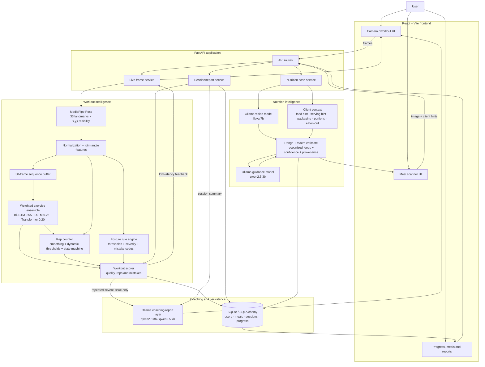
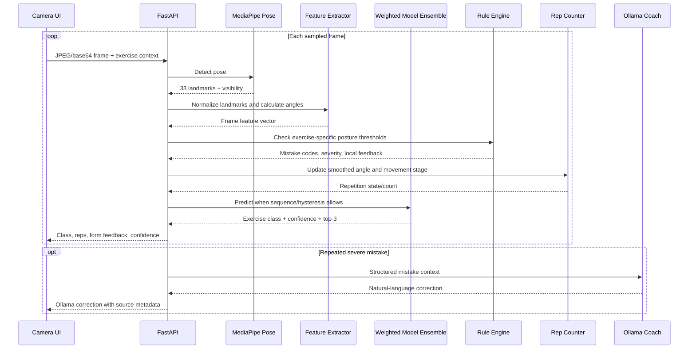
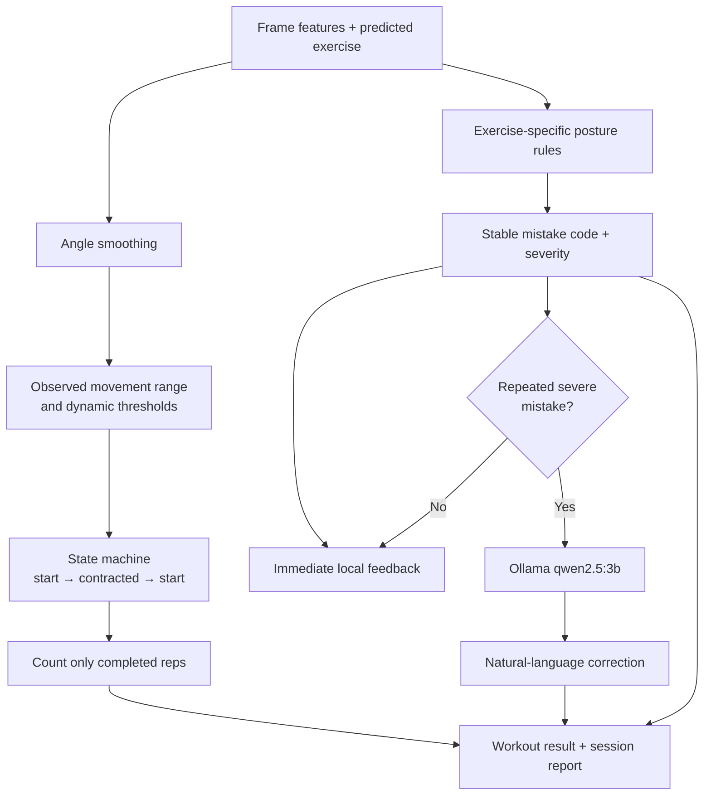
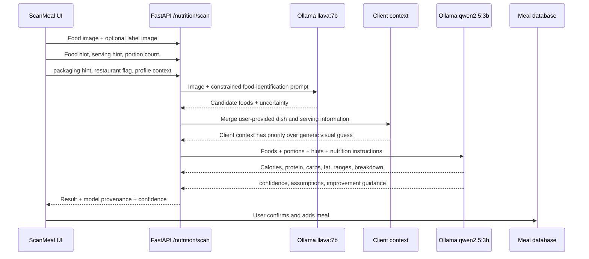

# FormFix AI — upgraded Mermaid architecture

This version updates the architecture in the mini-project report to match the implemented application. It includes the real-time workout path, model training path, weighted ensemble, rule engines, Ollama coaching, and nutrition scanning.

## 1. Overall system architecture



## 2. Real-time workout inference



## 3. Training architecture

```mermaid
flowchart LR
    RAW[dataset/raw_videos/<label>]
    PRE[preprocess_dataset.py]
    MP[MediaPipe pose extraction]
    NORM[Normalize around hip center<br/>scale by torso size]
    ANG[Joint-angle and landmark features]
    WIN[Sliding windows<br/>30 frames · stride 15]
    NPZ[exercise_sequences.npz<br/>X: T×132 · y · label_names]
    SPLIT[Stratified train/validation split<br/>class weights]

    RAW --> PRE --> MP --> NORM --> ANG --> WIN --> NPZ --> SPLIT

    SPLIT --> LSTM[Baseline LSTM training]
    SPLIT --> BILSTM[BiLSTM training]
    SPLIT --> TRANS[Transformer training]

    LSTM --> E1[Accuracy · loss · F1<br/>models/exercise_lstm.keras]
    BILSTM --> E2[Accuracy · loss · F1<br/>models/exercise_bilstm.keras]
    TRANS --> E3[Accuracy · loss · F1<br/>models/posture_transformer.keras]

    E1 & E2 & E3 --> TEST[Held-out evaluation<br/>confusion matrix · top-1/top-3]
    TEST --> REG[Model registry + label_names.json]
    REG --> SERVE[MultiModelExercisePredictor]
```



## 4. Workout model architectures

### 4.1 MediaPipe and feature representation

```mermaid
flowchart LR
    FRAME[RGB camera frame] --> MP[MediaPipe Pose]
    MP --> LM[33 landmarks<br/>(x,y,z,visibility)]
    LM --> CENTER[Hip-center translation]
    CENTER --> SCALE[Torso-size scaling]
    SCALE --> ANGLES[Angles<br/>knee · hip · elbow · shoulder]
    SCALE --> LANDMARKS[Normalized landmarks]
    ANGLES & LANDMARKS --> VECTOR[132-value frame vector]
    VECTOR --> SEQ[30-frame sequence]
```

### 4.2 Baseline LSTM

```mermaid
flowchart LR
    I[Input<br/>30 × 132] --> L1[LSTM 256<br/>return_sequences=true]
    L1 --> N1[LayerNorm] --> D1[Dropout 0.30]
    D1 --> L2[LSTM 128<br/>return_sequences=true]
    L2 --> N2[LayerNorm] --> D2[Dropout 0.25]
    D2 --> L3[LSTM 64]
    L3 --> N3[LayerNorm] --> D3[Dropout 0.20]
    D3 --> H1[Dense 128 GELU] --> H2[LayerNorm + Dropout 0.15]
    H2 --> H3[Dense 64 GELU + Dropout 0.10]
    H3 --> O[Dense num_classes<br/>Softmax]
```



### 4.3 BiLSTM primary classifier

```mermaid
flowchart LR
    I[Input<br/>30 × 132] --> B1[Bidirectional LSTM 256×2]
    B1 --> N1[LayerNorm + Dropout 0.35]
    N1 --> B2[Bidirectional LSTM 128×2]
    B2 --> N2[LayerNorm + Dropout 0.30]
    N2 --> B3[Bidirectional LSTM 64×2]
    B3 --> N3[LayerNorm + Dropout 0.20]
    N3 --> POOL[Global Average Pool +<br/>Global Max Pool → Concatenate]
    POOL --> D1[Dense 256 GELU<br/>LayerNorm + Dropout 0.20]
    D1 --> D2[Dense 128 GELU<br/>Dropout 0.15]
    D2 --> O[Dense num_classes<br/>Softmax]
```



### 4.4 Transformer comparison model

```mermaid
flowchart LR
    I[Input<br/>30 × 132] --> P[Dense projection 128]
    P --> POS[Sinusoidal positional encoding]
    POS --> T1[Transformer block ×4]
    T1 --> ATTN[8-head self-attention<br/>pre-LayerNorm + residual]
    ATTN --> FFN[Feed-forward 256<br/>GELU + dropout + residual]
    FFN --> POOL[Global average + max pooling]
    POOL --> D1[Dense 128 GELU<br/>LayerNorm + Dropout]
    D1 --> D2[Dense 64 GELU + Dropout]
    D2 --> O[Dense num_classes<br/>Softmax]
```



## 5. Deterministic movement engines and Ollama boundary



This boundary is important: the real-time rep count and safety/form decision do not depend on Ollama. Ollama improves wording and summaries, while MediaPipe, the trained classifiers, and deterministic rules produce the time-sensitive decision.

## 6. Nutrition scanner architecture



## 7. Recommended report wording

Use “hybrid AI architecture” in the report:

- **Computer vision:** MediaPipe Pose extracts landmarks.
- **Trained temporal models:** LSTM, BiLSTM and Transformer classify exercise sequences.
- **Deterministic biomechanics:** angle rules and a state machine handle form errors and repetitions.
- **Generative AI:** Ollama (`llava:7b`, `qwen2.5:3b`, `qwen2.5:7b`) identifies meal content when available, rewrites coaching feedback, and produces reports.
- **Important limitation:** calorie and macro values remain estimates; visual scanning cannot guarantee 90% accuracy for unknown portions without a measured serving or nutrition label.

The original report’s architecture figures are therefore upgraded with the actual ensemble, input-hint path, nutrition path, model provenance, and fallback boundary. Source report: `MiniProject-Page-Numbers.docx-7.pdf`.
